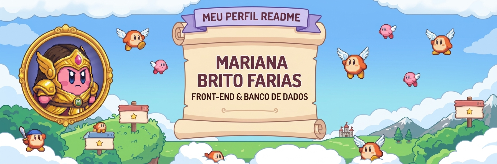

<!-- Banner Personalizado com Tema Kirby -->

---

---

### 🌸 Sobre Mim

- 🎓 **Atualmente cursando ADS**, com foco em me tornar Analista de Dados Júnior.
- ✨ Apaixonada pelo desenvolvimento web e a criação de interfaces incríveis (**Front-End**).
- 💾 Interessada na organização e manipulação eficiente de dados (**Banco de Dados**).
- 📚 Adora ler e escrever ficção fantástica nas horas vagas.
- 🎮 Adora jogos clássicos e fofos como Kirby!

---

### 🛠️ Tecnologias e Ferramentas

  <!-- Linguagens e Banco de Dados -->
  
  
  
  
  
  
  
  
  <!-- Inteligência Artificial e Ferramentas -->
  
  
  
  

---

  <i>"Transformando ideias, dados e códigos em soluções com um toque de leveza!" 🚀✨</i>
